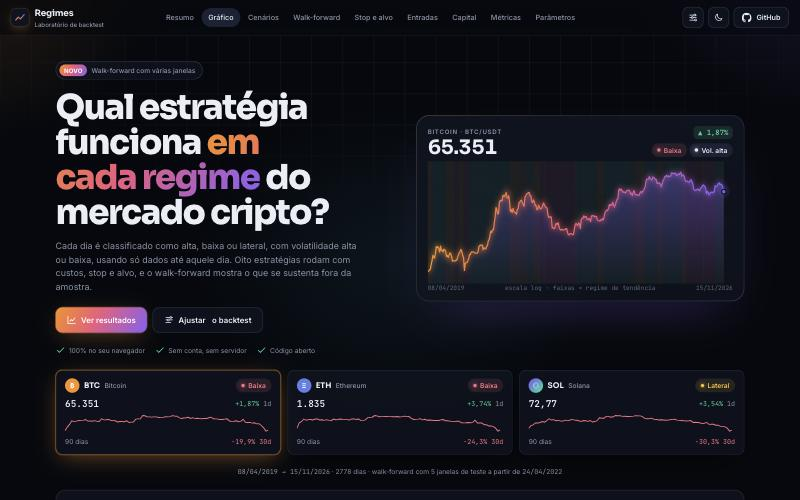
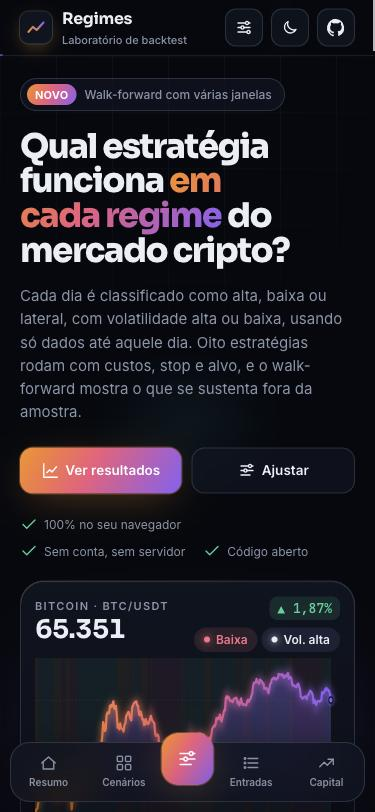
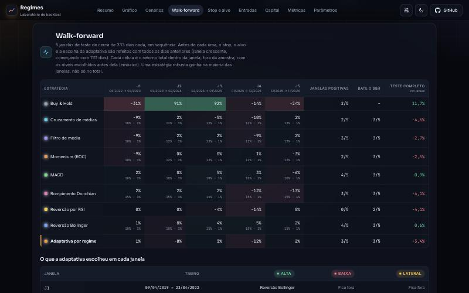
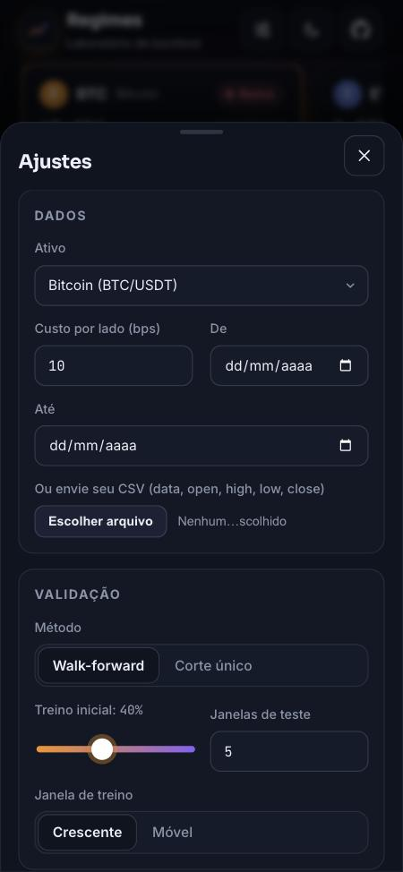

# Laboratório de Regimes

Backtest de estratégias cripto separado por **regime de mercado**: tendência (alta, baixa, lateral)
× volatilidade (alta, baixa). É uma página HTML única: todo o cálculo roda no seu navegador,
com os candles diários embutidos. Não há servidor, conta nem nuvem.

**Site:** https://felipeweirich1.github.io/btcanal/

> Não é recomendação de investimento. Resultado passado não garante resultado futuro.
> Otimizar parâmetros no histórico gera overfitting; veja as limitações abaixo.

<p>
  
  
</p>
<p>
  
  
</p>

## O que a página faz

- **Regime**: preço vs SMA(200) com faixa de ±5% e inclinação da média (tendência);
  volatilidade realizada de 30 dias vs mediana do ano anterior. Usa só dados até o dia.
- **8 estratégias**: buy & hold, cruzamento de médias, filtro de média, momentum (ROC), MACD,
  Donchian, reversão por RSI e por Bollinger. Sinal no fechamento, posição no dia seguinte.
- **Filtro de tendência** (ligado por padrão): comprado só em alta, vendido só em baixa.
- **Stop loss e take profit** checados no open/high/low do dia, com custo por lado.
- **Otimização de stop/alvo** por "mais wins", "melhor expectativa" ou "melhor Sharpe".
  A página avisa: "mais wins" tende a escolher alvo curto com stop largo, que dá acerto alto
  e expectativa negativa.
- **Validação**: corte único treino/teste ou **walk-forward** com várias janelas (ver abaixo).
- **Estratégia adaptativa**: em cada regime, usa a estratégia que venceu no treino.
- Lista de entradas com filtro de período, curvas de capital, matriz estratégia × cenário.

## Estrutura

```
src/template.html        código-fonte da página (HTML, CSS e JS); o marcador /*DATA*/ recebe os dados
data/<PAR>.json          candles diários [[dia, open, high, low, close], ...], dia = dias desde 1970-01-01 UTC
data/all.json            todos os pares juntos (é o que vai embutido)
scripts/update-data.sh   baixa candles novos da Binance e regenera a página
scripts/build.sh         gera index.html a partir do template e de data/all.json
index.html               página gerada, servida pelo GitHub Pages (não edite à mão)
docs/CONTEXTO.md         notas técnicas do motor e lista de melhorias
docs/img/                capturas de tela
```

## Uso local

Abra `index.html` direto no navegador (duplo clique). Funciona offline.

Para servir por HTTP (opcional):

```sh
ruby -run -e httpd -- --port=8765 .
# ou: python3 -m http.server 8765
```

## Atualizar os dados

Requer `curl` e `jq` (o macOS já traz os dois).

```sh
sh scripts/update-data.sh               # BTCUSDT ETHUSDT SOLUSDT
sh scripts/update-data.sh BTCUSDT XRPUSDT  # outros pares; baixa o histórico todo se for novo
git add data index.html && git commit -m "Atualiza dados" && git push
```

O script usa a API pública de dados de mercado da Binance
(`data-api.binance.vision/api/v3/klines`, intervalo 1d, sem chave), pagina para trás até
encontrar o último dia salvo, descarta o candle do dia corrente (ainda aberto) e regenera `index.html`.

Depois de editar `src/template.html`, rode `sh scripts/build.sh` e faça commit do `index.html`.

## Limitações

- **Overfitting**: escolher estratégia, parâmetros, stop e alvo olhando o histórico infla o resultado.
  Use o teste fora da amostra (ou o walk-forward) só para conferir, não para escolher.
- Só candles **diários**: stop e alvo no mesmo candle contam como stop (hipótese pessimista);
  não há dados intradiários para saber a ordem real.
- Sem slippage além do custo fixo por lado, sem funding de perpétuos, sem liquidez/tamanho de ordem.
- Histórico curto em termos de regimes: poucos ciclos completos de alta e baixa, então os números
  por regime têm amostras pequenas.
- Dados da Binance spot (USDT). Outras corretoras e pares podem diferir.

## Licenças de referência

Código próprio. Ideias de saídas (trailing stop, tabela de ROI) inspiradas no Freqtrade (GPL),
sem cópia de código. Trechos portados de bibliotecas MIT/BSD trazem o aviso de licença junto ao código.
